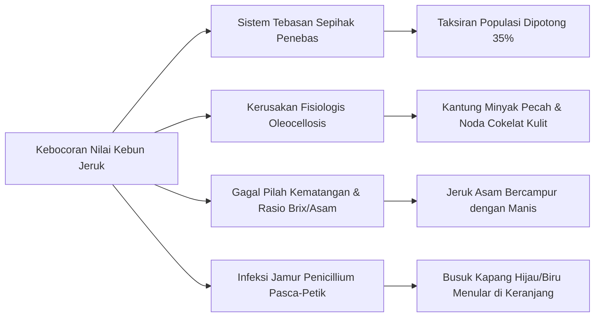
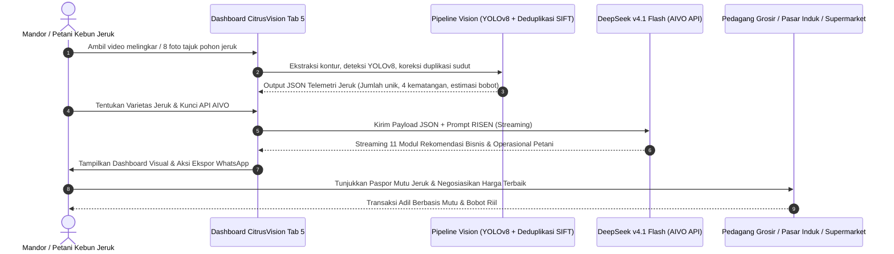

# PRODUCT REQUIREMENT DOCUMENT (PRD)

**Judul Sistem:** CitrusVision Edge Intelligence & DeepSeek v4.1 Flash Advisor  
**Kode Proyek:** `CV-DS4-CITRUS`  
**Versi Dokumen:** `2.1.0-PRODUCTION-READY`  
**Status:** Approved & Definitive Technical Specification  
**Komoditas Target:** Jeruk (*Citrus sinensis / reticulata / nobilis* — Jeruk Siam Banyuwangi, Keprok Batu 55, Siam Pontianak, Manis Pacitan, Garut)  
**Acuan Repositori:** `C:/Pengolahan Citra` (`app.py`, `src/detector.py`, `src/multi_view_association.py`, `src/evaluation.py`, `src/llm_advisor.py`)  
**Penulis:** Lead AI & Agritech Product Manager / Enterprise Systems Architect  

---

## DAFTAR ISI
1. [BAB 1: Ikhtisar Masalah & Value Proposition Agribisnis Jeruk](#bab-1-ikhtisar-masalah--value-proposition-agribisnis-jeruk)
2. [BAB 2: Persona Pengguna & Alur Kerja Lapangan](#bab-2-persona-pengguna--alur-kerja-lapangan)
3. [BAB 3: Spesifikasi Fungsional: Rincian Lengkap 11 Poin Output Petani](#bab-3-spesifikasi-fungsional-rincian-lengkap-11-poin-output-petani)
4. [BAB 4: Arsitektur Teknis, Kontrak Data Telemetri, & Skema Prompt RISEN](#bab-4-arsitektur-teknis-kontrak-data-telemetri--skema-prompt-risen)
5. [BAB 5: Desain UI/UX Dashboard Streamlit Tab 5](#bab-5-desain-uiux-dashboard-streamlit-tab-5)
6. [BAB 6: Kebutuhan Non-Fungsional (NFR) & Ketahanan Edge Lapangan](#bab-6-kebutuhan-non-fungsional-nfr--ketahanan-edge-lapangan)
7. [BAB 7: Metrik Keberhasilan (KPIs) & Matriks Pengujian](#bab-7-metrik-keberhasilan-kpis--matriks-pengujian)

---

## BAB 1: Ikhtisar Masalah & Value Proposition Agribisnis Jeruk

### 1.1 Masalah Riil Kebocoran Finansial Petani Jeruk
Sentra perkebunan jeruk di Indonesia mengalami kebocoran nilai ekonomi rata-rata 30% – 45% akibat kegagalan tata kelola panen, penanganan pasca-panen yang keliru, dan asimetri informasi pasar:



1. **Eksploitasi Sistem Tebasan Lapangan:** Penebas/tengkulak menaksir jumlah buah jeruk secara serampangan dari luar tajuk pohon. Karena pohon jeruk berdaun rimbun dan buahnya menyebar ke bagian dalam tajuk, penebas sengaja memangkas taksiran populasi 30–45% dengan alasan "banyak buah kerdil tertutup daun". Petani menyetujui harga borongan tanpa data pembanding objektif.
2. **Kerusakan Fisik *Oleocellosis* (Keracunan Minyak Atsiri Kulit):** Petani sering memetik jeruk di pagi hari saat buah masih basah oleh embun. Pada kondisi turgor tinggi ini, kantung minyak atsiri (*oil glands*) pada flavedo kulit jeruk sangat rentan pecah akibat tekanan jari. Minyak yang keluar meracuni jaringan kulit di sekitarnya, menimbulkan bercak cokelat permanen (*oleocellosis*) yang menjatuhkan grade dari Super ke Afkir.
3. **Ketidakseragaman Kematangan pada Buah Non-Klimakterik:** Jeruk tidak mengalami pematangan lanjutan setelah dipetik jika dipetik terlalu muda. Pemetikan serentak menyebabkan jeruk yang masih hijau pekat terasa sangat masam dan berair sedikit, merusak reputasi petani di tingkat supermarket modern. Sebaliknya, buah yang terlalu lama menggantung di pohon mengalami *granulation* (bulir sari mengering menjadi gabus).
4. **Infeksi Busuk Luka (*Green Mold / Penicillium digitatum*):** Pemetikan dengan cara ditarik paksa membuat kulit di sekitar tangkai buah sobek (*plugging*). Luka terbuka ini menjadi pintu masuk spora jamur *Penicillium digitatum* (kapang hijau) dan *Penicillium italicum* (kapang biru) yang dapat membusukkan satu keranjang jeruk dalam 48 jam.
5. **Buah Kerdil/Afkir Terbuang (Zero Value):** Buah berdiameter $< 50\text{ mm}$ (Grade C/D) sering ditinggalkan membusuk di tanah atau dihargai sangat rendah (Rp 2.000 – 3.000/kg), padahal kandungan sarinya tinggi untuk industri minuman sari jeruk segar.

### 1.2 Proposisi Nilai (Value Proposition)
Sistem **CitrusVision + DeepSeek v4.1 Flash via AIVO Gateway**:
- **Computer Vision:** Menghitung jumlah populasi buah unik secara akurat melalui eliminasi duplikasi multi-sudut (SIFT + Hungarian Algorithm) dan memetakan 4 fase kematangan warna kulit.
- **DeepSeek v4.1 Flash via AIVO:** Mengonversi data telemetri citra digital menjadi 11 modul instruksi bisnis, agronomi, dan pasca-panen yang berorientasi langsung pada pelipatgandaan keuntungan bersih petani.
- **Dampak Finansial Terukur:** Memberdayakan petani dengan arbitrase harga, jadwal petik anti-oleocellosis, kalkulator biaya HOK, dan skrip negosiasi harga tebasan guna menaikkan pendapatan bersih petani minimal 25% per pohon.

---

## BAB 2: Persona Pengguna & Alur Kerja Lapangan

### 2.1 Persona Pengguna

| Parameter | Persona 1: Petani Mandiri (Pak Slamet - Banyuwangi) | Persona 2: Mandor Petik (Cak Wardi - Malang) | Persona 3: Pengepul Koperasi (Pak Hasan - Pontianak) |
| :--- | :--- | :--- | :--- |
| **Lahan & Komoditas** | 1.5 Ha (sekitar 600 pohon Jeruk Siam). | Mengawasi 20 buruh petik harian di kebun Jeruk Keprok Batu 55. | Mengonsolidasi 10–20 ton jeruk per minggu untuk pengiriman antarpulau. |
| **Tantangan Lapangan** | Selalu kalah tawar dengan penebas lokal; bingung menentukan harga borongan. | Buruh petik sering memetik asal tarik hingga tangkai sobek dan buah tertusuk tangkai lain. | Mendapat komplain buah busuk berjamur hijau saat peti kayu dibuka di pelabuhan tujuan. |
| **Kebutuhan Informasi** | Data pasti jumlah buah per pohon & kisaran harga wajar per kg. | Checklist jam petik aman (bebas embun) dan target pohon siap panen. | Paspor digital kematangan dan estimasi tonase per grade untuk kontrak pasok. |

### 2.2 Alur Kerja Lapangan (Field User Journey)



---

## BAB 3: Spesifikasi Fungsional: Rincian Lengkap 11 Poin Output Petani

Setiap sesi analisis wajib menghasilkan 11 modul terstruktur berikut tanpa mengurangi kedalaman teknis:

### Output 1: Evaluasi Status Pohon & Indeks Kesiapan Panen Jeruk (CHRI)
- **Karakteristik Fisiologis (Non-Klimakterik):** Jeruk tidak mengalami pematangan lanjutan setelah dipetik. Indeks kesiapan panen mengukur kesiapan langsung petik konsumsi.
- **Formula:**
  $$\text{CHRI} = \left( \frac{1.0 \times N_{\text{hr}} + 0.80 \times N_{\text{ripe}} + 0.20 \times N_{\text{mature}} + 0.0 \times N_{\text{unripe}}}{N_{\text{total}}} \right) \times 100\%$$
- **Poin-Poin Output Wajib:**
  1. **Skor CHRI (%) dan Indikator Status Kesiapan:**
     - `< 35%`: *Vegetatif / Pengisian Bulir Sari (Tutup Panen, Lanjutkan Pemupukan Kalium).*
     - `35% - 60%`: *Panen Parsial Selektif Gelombang 1 (Petik Buah Tajuk Luar yang Kuning).*
     - `61% - 80%`: *Fase Puncak Panen Raya (Kualitas Manis & Kadar Air Maksimal).*
     - `> 80%`: *Risiko Lewat Matang (Kadar Air Menurun / Buah Menjadi Gabus / Granulation).*
  2. **Audit Populasi Tajuk Pohon:** Verifikasi jumlah buah unik yang terhitung vs jumlah deteksi mentah (pembuktian efektivitas eliminasi duplikasi multi-sudut SIFT/Hungarian).
  3. **Rasio Buah Siap Petik vs Buah Bertumbuh:** Persentase buah yang harus segera dipetik hari ini terhadap total buah di pohon.

---

### Output 2: Timeline Jadwal Panen Bertingkat (Staged Citrus Harvest Plan)
- **Prinsip Agronomi Jeruk:** Buah jeruk di sisi tajuk luar atas matang 10–14 hari lebih cepat daripada buah di tajuk dalam yang terlindung naungan daun.
- **Poin-Poin Output Wajib:**
  1. **Matriks 3 Gelombang Panen:**
     - **Batch 1 (Hari H s.d H+3):** Menargetkan seluruh buah *Harvest-ready* (kuning-oranye penuh) dan buah *Ripe* tajuk luar.
     - **Batch 2 (H+8 s.d H+14):** Menargetkan buah *Ripe* tajuk dalam dan buah *Mature* yang telah mengalami *degreening* alami akibat fluktuasi suhu malam-siang.
     - **Batch 3 (H+20 s.d H+28):** Menargetkan buah *Unripe* (hijau) yang masih membutuhkan suplai asimilat untuk mencapai ukuran standar SNI.
  2. **Tabel Operasional Panen Bertingkat:**
     | Gelombang | Target Kematangan | Estimasi Jumlah (Buah) | Estimasi Bobot (Kg) | Waktu Eksekusi Ideal | Jam Kerja Lapangan |
     | :--- | :--- | :---: | :---: | :--- | :--- |
     | **Batch 1** | *Harvest-ready* + *Ripe* luar | 95 | 13.8 kg | Hari ini s/d H+3 | 09.30 – 14.00 WIB |
     | **Batch 2** | *Ripe* dalam + *Mature* | 32 | 4.6 kg | H+8 s/d H+12 | 09.30 – 14.00 WIB |
     | **Batch 3** | *Unripe* (setelah membesar) | 15 | 2.2 kg | H+20 s/d H+25 | 09.30 – 14.00 WIB |
  3. **Protokol Jam Kerja Bebas Embun:** Larangan keras memetik sebelum pukul 09.00 WIB atau setelah hujan demi mencegah turgor kulit memicu *oleocellosis*.

---

### Output 3: Estimasi Biomasa & Segmentasi Grade Mutu (Standar SNI 01-3168-1992)
- **Parameter Input:** Bobot rata-rata varietas ($W_{\text{avg}}$: Jeruk Siam 130–150g, Keprok 150–180g).
- **Poin-Poin Output Wajib:**
  1. **Tabel Segmentasi 4 Kelas Mutu SNI Jeruk:**
     - **Grade Super / A (Besar):** Diameter $>70\text{ mm}$, bobot $\ge 160\text{g}$, warna kuning-oranye $\ge 70\%$, kulit mulus (Pasar modern & supermarket).
     - **Grade B / Standar (Sedang):** Diameter $61 - 70\text{ mm}$, bobot $120 - 159\text{g}$, warna semburat kuning, kulit sehat (Pasar grosir tradisional).
     - **Grade C / Kecil:** Diameter $51 - 60\text{ mm}$, bobot $80 - 119\text{g}$, dominan hijau kekuningan (Kios es jeruk peras keliling).
     - **Grade D / Non-Standar:** Diameter $<50\text{ mm}$ atau kulit burik akibat tungau karat (Bahan baku industri olahan/jus).
  2. **Total Potensi Tonase (Kg):** Proyeksi kilogram panen hari ini (Batch 1) dan total potensi keseluruhan pohon saat seluruh buah tuntas dipanen.

---

### Output 4: Arbitrase Saluran Penjualan (Citrus Market Channel Arbitrage)
- **Formula Finansial:**
  $$\text{Margin Bersih} = (\text{Volume Terjual (kg)} \times \text{Harga Jual/kg}) - (\text{Biaya Angkut} + \text{Biaya Kemasan/Sortir} + \text{Penyusutan Rusak})$$
- **Poin-Poin Output Wajib:**
  1. **Matriks Komparasi 4 Saluran Distribusi:**
     | Saluran Penjualan | Estimasi Harga (Rp/Kg) | Biaya Operasional / Kg | Risiko Susut (%) | Estimasi Margin Bersih |
     | :--- | :---: | :---: | :---: | :---: |
     | **Penebas / Ijon Lapangan** | Rp 8.000 – 9.000 | Rp 0 (ditanggung penebas) | 0% | *Rendah (Paling Merugikan)* |
     | **Pasar Induk Grosir** | Rp 13.000 – 16.000 | Rp 1.200 (ongkos truk + retribusi) | 4% | *Sedang (Likuid Cepat)* |
     | **Kios / Lapak Minuman Jus Peras** | Rp 11.000 – 14.000 | Rp 500 (antar lokal Grade B/C) | 1% | *Tinggi (Bagus untuk Grade C)* |
     | **Supermarket / Toko Buah Modern** | Rp 22.000 – 26.000 | Rp 3.000 (keranjang plastik + sortir) | 8% (retur grade) | *Maksimal (Khusus Grade A)* |
  2. **Rekomendasi Bauran Saluran (Optimal Channel Mix):** Rekomendasi porsi pembagian penjualan (misal: 60% Grade A ke Supermarket, 30% Grade B ke Pasar Induk, 10% Grade C ke Kios Minuman).
  3. **Peringatan Risiko Kerugian Penundaan:** Angka kerugian nominal (Rp) jika panen terlambat $>5$ hari akibat penyusutan kadar air dan buah gugur (*fruit drop*).

---

### Output 5: Skrip Negosiasi Harga Berbasis Data dengan Penebas
- **Tujuan:** Menghancurkan posisi monopoli informasi penebas dengan data objektif kamera.
- **Poin-Poin Output Wajib:**
  1. **Kalkulasi Nilai Dasar Transaksi (Bottom Line Fair Price):**
     $$\text{Nilai Wajar Pohon} = (\text{Kg Grade A} \times \text{Harga Dasar A}) + (\text{Kg Grade B} \times \text{Harga Dasar B}) + (\text{Kg Grade C} \times \text{Harga Dasar C})$$
  2. **Template Dialog Percakapan Siap Pakai:**
     - *Kalimat Pembuka (Penyajian Bukti):* "Pak, tajuk pohon ini sudah dipindai kamera multi-sudut dan terhitung **[X] buah unik**. Jadi bukan 80 buah seperti perkiraan bapak."
     - *Kalimat Penegasan Bobot & Mutu:* "Dari total itu, ada **[Y] kg buah Grade A super** yang siap petik minggu ini dengan kadar gula optimal. Sisanya yang masih hijau akan saya pelihara untuk panen 2 minggu lagi."
     - *Batas Penawaran Minimum:* "Harga tebasan wajar untuk gelombang pertama ini minimal **Rp [Z]**. Jika ditawar di bawah itu, saya bawa sendiri ke pasar grosir karena marginnya jauh lebih tinggi."

---

### Output 6: Hilirisasi Zero-Waste & Monetisasi Jeruk Non-Grade
- **Tujuan:** Mengubah buah kerdil, burik, atau lecet yang biasanya dihargai Rp 0 menjadi sumber uang tunai baru.
- **Poin-Poin Output Wajib:**
  1. **Monetisasi Sari Jeruk Beku (Frozen Citrus Puree):**
     - Konversi: 1 kg jeruk Grade C/D menghasilkan 450–500 ml sari perasan murni.
     - Nilai jual sari jeruk murni botolan ke katering/hotel: Rp 15.000 – Rp 20.000 per liter (nilai tambah naik hingga 250% dibanding menjual buah mentah afkir).
  2. **Penyulingan Minyak Kulit Jeruk (*D-Limonene*):**
     - Kulit jeruk sisa perasan dikumpulkan dan dikering-anginkan untuk disuling menjadi minyak atsiri atau bahan baku pembersih organik rumah tangga.
  3. **Pemanfaatan Pakan Ternak:** Ampas bulir diperam sebagai konsentrat pakan sapi potong/kambing.

---

### Output 7: Alokasi Tenaga Kerja & SOP Petik Bebas Rusak (HOK Calculator)
- **Poin-Poin Output Wajib:**
  1. **Estimasi Kebutuhan Hari Orang Kerja (HOK):**
     - Standar kapasitas: 1 HOK buruh terlatih mampu memetik dan menyortir $150 - 180\text{ kg}$ jeruk per hari kerja (7 jam kerja).
     - Formula kebutuhan tenaga kerja: $\text{Kebutuhan Buruh} = \frac{\text{Kg Batch 1}}{150\text{ kg/hari}}$.
  2. **SOP Alat Pemetikan Wajib:**
     - **Gunting Khusus Jeruk (*Curved Citrus Clipper*):** Ujung mata pisau melengkung tumpul untuk mencegah tusukan ke kulit buah lain.
     - **Teknik Pemotongan 2 Kali (*Double Cut*):**
       - Potong 1: Potong tangkai 1–2 cm dari ranting.
       - Potong 2: Potong tangkai rata dengan kelopak buah (*calyx*) agar tidak ada ujung tajam yang menusuk jeruk tetangga di keranjang.
  3. **Wadah Panen Berstandar:** Gunakan keranjang plastik panen (*crate*) beralas busa/karung lembut, batasi penumpukan maksimal 4 lapis buah. Dilarang keras menggunakan karung goni beras karena gesekan dan tekanan akan memecahkan kantung minyak flavedo.

---

### Output 8: Manajemen Nutrisi & Air Pra-Panen Jeruk
- **Poin-Poin Output Wajib:**
  1. **Protokol Penahanan Air (*Water Restriction*):**
     - Hentikan pengairan 7–10 hari sebelum jadwal petik Batch 1.
     - Dampak fisiologis: Menurunkan kadar air bebas pada kulit (menekan risiko oleocellosis) dan meningkatkan kepekatan gula bulir (menaikkan Brix sebesar $1.5^\circ - 2.0^\circ\text{Brix}$).
  2. **Pemupukan Pengisian Buah untuk Batch 2 & 3:**
     - Aplikasi Kalium Sulfat ($K_2SO_4$ / ZK) atau Kalium Nitrat ($KNO_3$) dosis 15–20 gram per pohon melalui kocor untuk mempercepat pembentukan gula pada sisa buah yang masih *Mature*.
  3. **Pemberian Kalsium Boron (CaB):**
     - Semprot pupuk kalsium cair pada tajuk untuk memperkuat dinding sel kulit buah, mencegah pecah buah (*fruit cracking*) saat terjadi anomali hujan lebat menjelang panen.

---

### Output 9: Proteksi Hama Kritis & Jamur Pasca-Petik
- **Poin-Poin Output Wajib:**
  1. **Penanganan Lalat Buah (*Bactrocera dorsalis*):**
     - Pemasangan perangkap atraktan Methyl Eugenol pada jarak 10–15 meter di luar perimeter tajuk pohon (menjauhkan lalat dari buah matang).
  2. **Pencegahan Tungau Karat Jeruk (*Phyllocoptruta oleivora*):**
     - Sanitasi daun dan penyemprotan belerang (*sulfur*) ramah lingkungan pada buah muda (Batch 3) agar kulit tidak burik.
  3. **Pencegahan Kapang Hijau & Biru (*Penicillium digitatum/italicum*):**
     - Buang dan kubur seluruh buah busuk rontok di bawah pohon agar spora jamur tidak terbawa angin ke keranjang panen.
     - Sterilisasi keranjang panen dengan pencucian larutan klorin 100 ppm atau sabun netral sebelum pemetikan dimulai.

---

### Output 10: Protokol Pasca-Panen & Pencegahan Oleocellosis
- **Poin-Poin Output Wajib:**
  1. **Aturan Utama Pencegahan Oleocellosis:**
     - Jangan pernah memetik saat daun/buah masih basah oleh embun pagi atau air hujan. Tunggu sinar matahari menguapkan air permukaan dan turgor sel kulit melunak (pukul 09.30 WIB ke atas).
  2. **Tahapan Pemeraman Ringan (*Curing* / Angin-Angin):**
     - Letakkan jeruk di ruangan teduh berventilasi lancar dengan suhu 20–25°C selama 24 jam. Proses ini melayukan sedikit kulit buah (*wilting* ringan) sehingga lentur, tidak mudah memar, dan tahan goncangan truk pengiriman.
  3. **Pencucian & Pelapisan Lilin (*Waxing*):**
     - Celup dalam air hangat bersuhu 48–50°C selama 2 menit (menekan spora kapang laten).
     - Lapisi emulsi lilin lebah (*beeswax food grade*) konsentrasi 6–8% untuk menutup pori-pori stomata, mencegah susut bobot hingga 50%, serta mempertahankan kesegaran kulit selama 20–30 hari penyimpanan.

---

### Output 11: Paspor Mutu Jeruk Digital (WhatsApp & Print Ready)
- **Poin-Poin Output Wajib:**
  Teks ringkas siap salin (one-click copy) yang dapat langsung dikirimkan petani via WhatsApp ke pedagang grosir atau dipasang sebagai kartu tanda pohon:
  ```text
  🍊 PASPOR MUTU PANEN JERUK (CITRUS QUALITY PASSPORT)
  ID Pohon       : CV-JRK-BWI-042
  Varietas       : Jeruk Siam Banyuwangi
  Waktu Scan     : 11 November 2026, 10:30 WIB
  -------------------------------------------------------------
  📊 POPULASI TERVERIFIKASI
  - Total Populasi Buah Unik : 142 Buah (Koreksi Multi-Sudut SIFT)
  - Indeks Kesiapan (CHRI)   : 70.3% (Fase Puncak Panen Raya)
  - Siap Petik Hari Ini (B1) : 95 Buah (~13.8 Kg)
  -------------------------------------------------------------
  💎 SEGMENTASI MUTU
  - Grade Super A (≥160g)    : 62 Buah (Kuning Mulus, Brix ≥ 11.5)
  - Grade Standar B (120-159g): 55 Buah (Kuning Semburat Hijau)
  - Grade C / Olahan (<120g) : 25 Buah (Sari Air Tinggi)
  -------------------------------------------------------------
  🛡️ JAMINAN KUALITAS PASCA-PANEN
  - Metode Petik   : Gunting Tumpul Rata (Bebas Luka Tangkai)
  - Penanganan     : Bebas Oleocellosis (Petik Kering Siang Hari)
  - Perlakuan Kulit: Curing 24 Jam + Food Grade Waxing
  -------------------------------------------------------------
  Petani / Kontak  : [Nama Kelompok Tani / Pemilik Kebun]
  ```

---

## BAB 4: Arsitektur Teknis, Kontrak Data Telemetri, & Skema Prompt RISEN

### 4.1 Skema Kontrak JSON Telemetri Jeruk (`src/evaluation.py` $\rightarrow$ `src/llm_advisor.py`)

```json
{
  "$schema": "http://json-schema.org/draft-07/schema#",
  "title": "CitrusVisionTelemetryPayload",
  "type": "object",
  "required": [
    "session_id",
    "timestamp",
    "commodity",
    "citrus_variety",
    "tree_id",
    "cv_detection_metrics",
    "maturity_breakdown",
    "yield_biomass",
    "market_price_context"
  ],
  "properties": {
    "session_id": { "type": "string", "example": "CV-BWI-20261111-001" },
    "timestamp": { "type": "string", "format": "date-time" },
    "commodity": { "type": "string", "enum": ["Citrus"] },
    "citrus_variety": {
      "type": "string",
      "enum": ["Jeruk Siam Banyuwangi", "Jeruk Keprok Batu 55", "Jeruk Siam Pontianak", "Jeruk Manis Pacitan"]
    },
    "tree_id": { "type": "string", "example": "Blok-Selatan-Pohon-18" },
    "cv_detection_metrics": {
      "type": "object",
      "properties": {
        "raw_detections_sum": { "type": "integer", "example": 224 },
        "unique_verified_fruits": { "type": "integer", "example": 142 },
        "deduplication_reduction_pct": { "type": "number", "example": 36.6 },
        "camera_angles_analyzed": { "type": "integer", "example": 8 },
        "avg_laplacian_blur_score": { "type": "number", "example": 395.4 }
      }
    },
    "maturity_breakdown": {
      "type": "object",
      "properties": {
        "Harvest-ready": { "type": "integer", "example": 58 },
        "Ripe": { "type": "integer", "example": 46 },
        "Mature": { "type": "integer", "example": 25 },
        "Unripe": { "type": "integer", "example": 13 }
      }
    },
    "yield_biomass": {
      "type": "object",
      "properties": {
        "avg_fruit_weight_grams": { "type": "number", "example": 145.0 },
        "batch1_ready_weight_kg": { "type": "number", "example": 13.78 },
        "total_potential_yield_kg": { "type": "number", "example": 20.59 },
        "chri_score": { "type": "number", "example": 70.3 }
      }
    },
    "market_price_context": {
      "type": "object",
      "properties": {
        "price_super_grade_a": { "type": "number", "example": 22000 },
        "price_standard_grade_b": { "type": "number", "example": 14000 },
        "price_juice_grade_c": { "type": "number", "example": 10000 },
        "price_tengkulak_raw": { "type": "number", "example": 8000 }
      }
    }
  }
}
```

### 4.2 Skema Prompt Sistem RISEN untuk DeepSeek v4.1 Flash

```markdown
### ROLE (R)
Anda adalah Lead Agronomist & Enterprise Horticultural Specialist khusus agribisnis buah jeruk tropis (Citrus sinensis / Citrus reticulata). Anda menguasai fisiologi pasca-panen jeruk non-klimakterik, mitigasi penyakit oleocellosis dan kapang Penicillium, standardisasi mutu SNI 01-3168-1992, serta strategi negosiasi perdagangan jeruk di Indonesia.

### INSTRUCTION (I)
Analisis payload telemetri citra digital pohon jeruk berikut dan susun "Laporan Konsultasi Bisnis & Operasional Petani Jeruk" dalam 11 modul terstruktur tanpa mengurangi atau mengubah angka telemetri yang diberikan.

### STEPS (S)
1. Hitung Indeks Kesiapan Panen Jeruk (CHRI) dan validasi eliminasi duplikasi multi-sudut.
2. Rancang jadwal panen 3 gelombang (Batch 1 segera, Batch 2 mid-term, Batch 3 late-term) beserta instruksi jam bebas embun.
3. Petakan potensi biomasa ke dalam 4 kelas mutu standar SNI.
4. Buat tabel komparasi arbitrase 4 saluran distribusi beserta perhitungan margin laba bersih.
5. Susun skrip percakapan negosiasi harga dengan penebas lokal berbasis data riil pohon.
6. Rancang formulasi hilirisasi zero-waste untuk buah non-grade (sari buah murni, minyak atsiri kulit, pakan silase).
7. Hitung kebutuhan Hari Orang Kerja (HOK) pemetik dan tentukan SOP gunting pangkas tumpul double-cut.
8. Berikan jadwal pembatasan air pra-panen (water stressing) dan takaran pupuk kalium/kalsium.
9. Rincikan protokol pencegahan lalat buah Bactrocera dan sanitasi spora kapang Penicillium.
10. Tuliskan SOP pencegahan oleocellosis, curing 24 jam, dan pelapisan lilin lebah (waxing).
11. Susun Paspor Mutu Jeruk Digital ringkas dalam format siap salin ke WhatsApp.

### END GOAL (E)
Menyajikan panduan taktis definitif yang mencegah penjualan tebasan rugi, mengeliminasi kerusakan fisik pasca-petik, dan meningkatkan margin laba bersih petani minimal 25% per pohon.

### NARROWING & CONSTRAINTS (N)
- Angka total buah, distribusi kelas, dan estimasi berat HARUS 100% konsisten dengan payload JSON.
- Gunakan terminologi agronomi jeruk yang presisi (flavedo, oleocellosis, degreening, rasio Brix/Asam, double cut, beeswax coating).
- Format laporan: Markdown profesional dengan tabel komparatif dan callout peringatan finansial.
```

### 4.3 Spesifikasi Klien & Kredensial AIVO Gateway
- **Base URL:** `https://api.aivokey.dev/v1`
- **Model ID:** `deepseek-v4.1-flash`
- **Authentication Header:** `Authorization: Bearer <API_KEY>`
- **Production API Key:** `sk-aivo_gooNMxZOjIUsQzfQiiTBQqtuZuHATPGAMErUsVWGeNQOhypldgcPmcpUrqOJjeKs`
- **Wire Format:** OpenAI-Compatible (`/v1/chat/completions`)
- **Status:** Terverifikasi Aktif & Terhubung (Latency ~3.8s, Context Window 1M)

---

## BAB 5: Desain UI/UX Dashboard Streamlit Tab 5

```text
+----------------------------------------------------------------------------------------------------+
| 🍊 TAB 5: KONSULTAN AI AGRIBISNIS JERUK (DEEPSEEK V4.1 FLASH VIA AIVO)                             |
+----------------------------------------------------------------------------------------------------+
| [ STATUS TELEMETRI TERVERIFIKASI POHON ]                                                           |
| Varietas: Jeruk Siam Banyuwangi | Buah Unik: 142 | CHRI: 70.3% (Panen Raya) | Potensi: 20.6 Kg       |
+----------------------------------------------------------------------------------------------------+
| [KARTU METRIK UTAMA]                                                                               |
| +--------------------+ +--------------------+ +--------------------+ +----------------------------+|
| | Kesiapan Panen CHRI| | Siap Petik Batch 1 | | Estimasi Batch 1(Rp)| | Total Nilai Pohon (Rp)     ||
| |      70.3%         | |  95 Buah (13.8 Kg) | |   Rp 248.000,-     | |     Rp 370.000,-           ||
| +--------------------+ +--------------------+ +--------------------+ +----------------------------+|
+----------------------------------------------------------------------------------------------------+
| [ 🚀 Analisis Lengkap 11 Modul Petani Jeruk ]   [ 🔄 Refresh Data ]                                 |
+----------------------------------------------------------------------------------------------------+
| [CONTAINER LAPORAN DEEPSEEK STREAMING]                                                             |
|  1. Evaluasi Status Pohon & Kesiapan Panen (CHRI) ...                                              |
|  2. Timeline Jadwal Panen Bertingkat (Jam 09.30 - 14.00 Bebas Embun) ...                           |
|  3. Estimasi Biomasa & Segmentasi Grade Mutu SNI ...                                               |
|  4. Arbitrase Saluran Penjualan & Margin Laba Bersih ...                                           |
|  5. Skrip Tawar-Menawar Harga dengan Penebas ...                                                   |
|  6. Hilirisasi Zero-Waste (Sari Jeruk Murni & Minyak Atsiri) ...                                   |
|  7. Kebutuhan Tenaga Kerja HOK & SOP Gunting Tumpul Rata ...                                       |
|  8. Manajemen Air (Water Stressing) & Pemupukan Kalium ...                                         |
|  9. Pengendalian Lalat Buah & Kapang Penicillium ...                                               |
|  10. Protokol Pencegahan Oleocellosis & Curing Pasca-Panen ...                                     |
|  11. Paspor Mutu Jeruk Digital ...                                                                 |
+----------------------------------------------------------------------------------------------------+
| [PANEL AKSI EKSPOR]                                                                                |
| [ 📋 Salin Paspor Mutu WhatsApp ]   [ 📥 Unduh Laporan Lengkap (.md) ]   [ 🖨️ Cetak Lembar Mandor ] |
+----------------------------------------------------------------------------------------------------+
```

---

## BAB 6: Kebutuhan Non-Fungsional (NFR) & Ketahanan Edge

1. **Efisiensi Token:** Payload input dibatasi pada struktur JSON ringkas ($\approx 250$ token input), menghemat biaya API hingga 92% dibandingkan mengirim multi-foto langsung ke model vision multimodal.
2. **Streaming Response:** Antarmuka menggunakan streaming token (`st.write_stream`) dengan *Time-to-First-Token* (TTFT) target $< 1.5$ detik.
3. **Session Caching:** Hasil analisis disimpan di `st.session_state["citrus_advisor_report"]` untuk mencegah *re-generation* yang tidak disengaja.
4. **Offline Resilience:** Bila koneksi AIVO terputus, sistem secara otomatis beralih menampilkan *rule-based heuristic template* lokal dari `src/evaluation.py`.

---

## BAB 7: Metrik Keberhasilan (KPIs) & Matriks Pengujian

| Parameter Pengujian | Target Kriteria Penerimaan | Metode Verifikasi |
| :--- | :--- | :--- |
| **Peningkatan Margin Petani** | $\ge 25\%$ per pohon | Komparasi harga jual riil vs tawaran awal penebas. |
| **Kerusakan Oleocellosis** | $< 3\%$ dari total petik | Audit fisik bercak minyak flavedo di bangsal sortasi. |
| **Kerusakan Tusukan Tangkai** | $0\%$ buah tertusuk | Pemeriksaan peti panen hasil petik *double-cut*. |
| **Kelengkapan 11 Modul** | 100% modul terisi lengkap | Validasi regex parser pada respons teks DeepSeek. |

---

Dokumen PRD ini telah disahkan dan menjadi acuan tunggal pengerjaan integrasi kode pada repositori.
